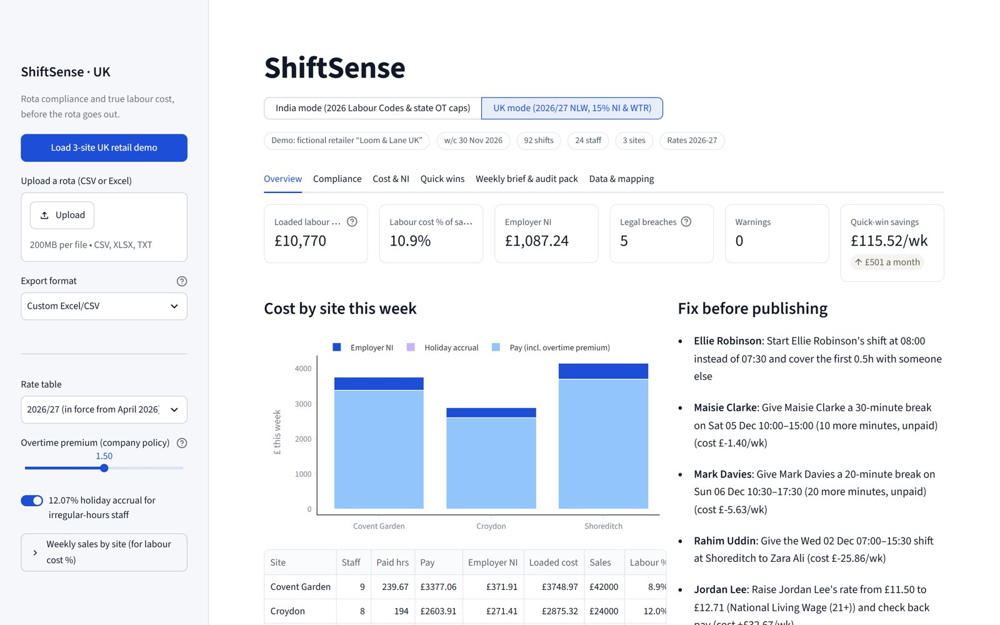
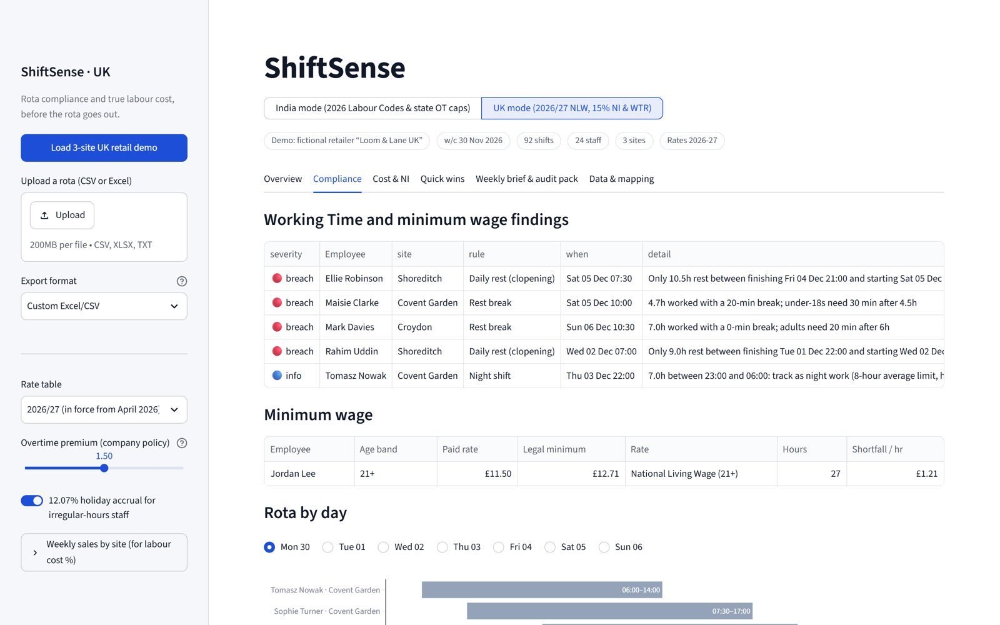
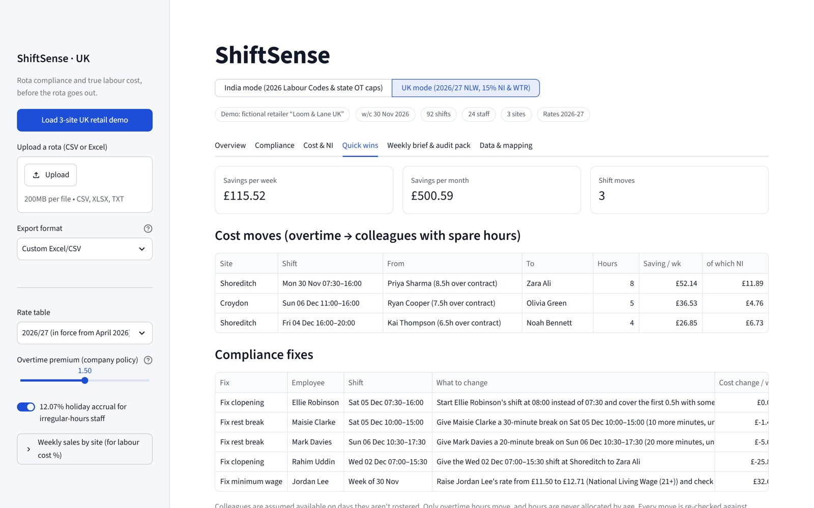
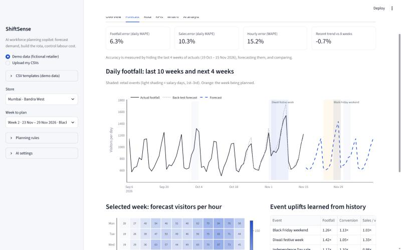
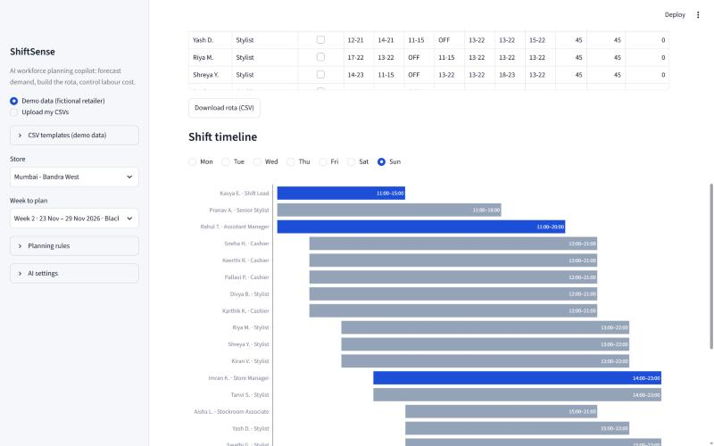
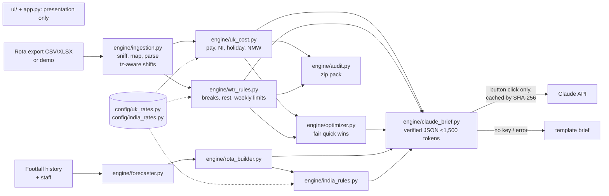

# ShiftSense: AI Workforce Planning Copilot

**ShiftSense plans and checks retail rotas. India mode forecasts demand and builds a rule-compliant rota; UK mode reads a real rota export and finds Working Time breaches, minimum-wage gaps and avoidable Employer NI and overtime cost, before the rota is published.**

Built for store managers, HR operations and workforce management (WFM) teams who still plan staffing in spreadsheets.



> Demo data is **synthetic**: a fictional retailer ("Loom & Lane") with 3 stores in India and 3 in the UK. No real company or employee data is used.

---

## Two modes, one app

| | **India mode** (planner) | **UK mode** (rota checker) |
|---|---|---|
| Question it answers | "What rota do we need next week?" | "Is the rota we're about to publish legal, and what does it really cost?" |
| Input | Hourly footfall/sales history + staff list (CSV) or demo data | A rota export from Deputy, Planday or a spreadsheet (CSV/XLSX), or the one-click demo |
| Rules | Labour Codes (in force since 21 Nov 2025): daily/weekly hours, state overtime caps, 2× overtime pay, women's night-work consent | Working Time Regulations, 2026/27 National Minimum Wage, 15% Employer NI, 12.07% irregular-hours holiday accrual, day-one SSP |
| Output | Forecast, rota, coverage heatmap, KPIs, what-if, Labour Codes findings | Breaches with fixes, true cost per person and site, quick-win shift moves (£/week), audit pack |
| Claude | Weekly report + "ask your workforce data" | Weekly Operations & Compliance Brief |

Switch with the toggle at the top. `?mode=uk` links straight to UK mode.

## The problem → the build → the value

| | |
|---|---|
| **Problem** | Rotas are built by hand. Peaks get under-staffed, quiet hours over-staffed, clopenings and missed breaks slip through, someone who just turned 21 stays on the old rate, and nobody knows the true labour cost (NI, holiday accrual, overtime premium) until payroll runs. |
| **Build** | A deterministic Python engine (forecasting, rota building, UK and India rule checks, cost and NI maths, a fair overtime optimiser) with 80 pytest tests, a Streamlit front end, and Claude writing the narrative from verified numbers only. |
| **Value** | Load the UK demo and in under 5 seconds you see 4 Working Time breaches, 1 minimum-wage breach, and £115.52 a week (£500.59 a month) of avoidable overtime and NI, each with a specific fix. |

## What's inside

**UK mode**
- **Import anything:** CSV or Excel up to 5 MB / 5,000 shifts; auto-detects delimiter (`,` `;` tab `|`) and encoding; Deputy, Planday and custom presets with an on-screen column mapper; UK day-first dates, decimal commas, `9:30 PM`, `0930`, Excel times; row-level error table instead of tracebacks.
- **Working Time checks** (per person, across all sites, in real elapsed time): 20-min break after 6h; 11h daily rest ("clopening"); 24h weekly rest; 48-hour week without opt-out; under-18s: 30-min break after 4.5h, 12h daily rest, 48h weekly rest, 8h/day and 40h/week; night shifts (3h+ between 23:00 and 06:00); overlapping shifts.
- **True labour cost:** pay, overtime premium (your policy), 12.07% holiday accrual for irregular-hours staff as a separate line, Employer NI at 15% above £96/week (£967 for under-21s and apprentices under 25), minimum-wage check by age band (from date of birth on the shift date), day-one SSP exposure, labour cost % by site.
- **Quick wins:** moves only *overtime* hours to colleagues with spare contracted hours, never below anyone's contract, never creating a new Working Time issue, and **never choosing people by age**. Savings are recalculated for both people. Plus a specific fix for every breach.
- **Audit pack (.zip):** every shift with its flags and loaded cost, the weekly brief, and metadata (UTC timestamp, rate-table version, SHA-256 of the uploaded file). Holiday records must be kept for 6 years from April 2026.
- **Rate tables:** 2026/27 (in force) and an April 2027 preview (£13.21 / £11.27 / £8.31, announced 28 Oct 2026).

**India mode**
- 4-week hourly forecast with event uplifts (Diwali, Black Friday, end-of-season sales, salary days) and an honest back-test (daily MAPE ~6% on demo data).
- Rota builder: key-holders open/close, availability, contracts, rest, working days, full-length shifts for full-timers, overtime rebalancing.
- KPIs, what-if slider, coverage heatmap.
- **Labour Codes tab:** state presets (Telangana, Karnataka, Maharashtra, Tamil Nadu, Gujarat, Haryana, Delhi, central sphere) chosen from the store's city, editable limits, overtime at 2×, quarterly overtime cap check, and women's night-work consent reminders.

| UK compliance | UK quick wins |
|---|---|
|  |  |
| **India: forecast** | **India: rota** |
|  |  |

## Architecture



```
workforce-copilot/
├── app.py                  shell: page setup, UK/India toggle, footer
├── CLAUDE.md               engineering rules for Claude Code sessions
├── config/
│   ├── uk_rates.py         versioned UK rates (2026-27, 2027-28 preview) + WTR limits, with sources
│   └── india_rates.py      Labour Codes state presets
├── engine/                 all maths, no Streamlit
│   ├── ingestion.py        CSV/XLSX loader, delimiter/encoding sniffing, Deputy/Planday mapping
│   ├── uk_cost.py          pay, Employer NI, holiday accrual, NMW, site allocation
│   ├── wtr_rules.py        Working Time checks
│   ├── optimizer.py        quick wins + compliance fixes
│   ├── india_rules.py      Labour Codes checks
│   ├── forecaster.py       demand forecast + back-test
│   ├── rota_builder.py     staffing requirement + greedy rota builder
│   ├── kpis.py, india_pipeline.py, demo_data.py, uk_demo.py
│   ├── claude_brief.py     verified payloads, prompts, API call, template fallbacks
│   └── audit.py            audit pack
├── ui/                     screens (common, charts, india_view, uk_view, ai_panel)
├── sample_data/uk_3site_retail_demo.csv
├── tests/                  80 pytest tests
└── docs/screenshots/
```

## Run it locally

Requires Python 3.10+.

```bash
cd workforce-copilot
```

```bash
python -m venv .venv
```

Windows:

```bash
.venv\Scripts\activate
```

macOS / Linux:

```bash
source .venv/bin/activate
```

```bash
pip install -r requirements-dev.txt
```

```bash
streamlit run app.py
```

The app opens at http://localhost:8501.

### Run the tests

```bash
pytest -v
```

80 tests cover the NI boundary (£95.99 vs £96.01; 20h at £12.71 = £23.73), under-21 and apprentice relief, minimum-wage bands and the 21st birthday, midnight and clock-change shifts, 10.5h clopenings across sites, under-18 breaks, weekly limits, semicolon/tab/Excel imports and malformed rows, the optimiser's fairness and savings, a zero-maths-drift check (every £ in the brief must exist in the verified data), the audit pack, and the original India forecast and rota.

### Switch on Claude (optional)

Get an API key from the [Anthropic Console](https://console.anthropic.com/) and either copy `.streamlit/secrets.toml.example` to `.streamlit/secrets.toml` (git-ignored) and paste it there, or set the `ANTHROPIC_API_KEY` environment variable. The key is never read from anywhere else, never shown, and never logged. Without a key every screen still works, with a template brief built from the same numbers.

Cost controls: Claude is called only when someone clicks a button; identical requests are served from cache (keyed by a SHA-256 of the payload); each visitor session gets `AI_CALLS_PER_SESSION` new calls (default 5). Also set a monthly spend limit in the Anthropic Console.

### Use your own data

- **UK mode:** upload a rota export. Required columns: employee ID (or name), hourly rate, start, end, and the date (unless start includes it). Optional: site, role, age band or date of birth, contract type (`fixed` / zero-hours / apprentice), unpaid break, 48-hour opt-out, contracted hours. Pick the Deputy or Planday preset, then confirm the mapping in **Data & mapping**. The **Download the demo rota file** button gives a working example.
- **India mode:** upload `demand.csv`, `staff.csv` and optionally `events.csv`. Download the templates under **CSV templates**.

## Deploy free on Streamlit Community Cloud

1. **Create a public GitHub repository**, e.g. `shiftsense`.
   - *No git needed:* on GitHub use **Add file → Upload files** and drag in everything in this folder **except** `.venv/`, `__pycache__/` and any `.streamlit/secrets.toml`.
   - *With git*, from this folder:
     ```bash
     git init
     ```
     ```bash
     git add .
     ```
     ```bash
     git commit -m "ShiftSense v2: UK compliance mode, tests"
     ```
     ```bash
     git branch -M main
     ```
     ```bash
     git remote add origin https://github.com/<your-username>/shiftsense.git
     ```
     ```bash
     git push -u origin main
     ```
2. Go to **[share.streamlit.io](https://share.streamlit.io)**, sign in with GitHub, choose **Create app**, pick the repo, branch `main`, file `app.py`, and a subdomain such as `shiftsense-demo`.
3. In **Advanced settings → Secrets** paste:
   ```toml
   ANTHROPIC_API_KEY = "your-key"
   AI_CALLS_PER_SESSION = "5"
   ```
   Optional: `CONTACT_EMAIL = "you@example.com"` shows the Multi-site Pro waitlist button (it opens an email to you), or `WAITLIST_URL = "https://your-form-link"` points it at a form. Without either, the button is hidden.
4. Click **Deploy** (first build 2–4 minutes). Share `https://<subdomain>.streamlit.app`, or `…/?mode=uk` for UK buyers.
5. Before every interview or outreach: open the link in a private window, click **Load 3-Site UK Retail Demo**, and check it renders without errors. Free apps sleep when idle and take a moment to wake.

## Statutory sources (checked November 2026)

- National Minimum Wage / Living Wage: [gov.uk/national-minimum-wage-rates](https://www.gov.uk/national-minimum-wage-rates); April 2027 rates announced 28 Oct 2026.
- Employer NI 2026–27: [gov.uk rates and thresholds for employers](https://www.gov.uk/guidance/rates-and-thresholds-for-employers-2026-to-2027).
- Day-one SSP from 6 April 2026: [Acas](https://www.acas.org.uk/statutory-sick-pay-changes-2026).
- Holiday records kept 6 years from 6 April 2026: [Acas](https://www.acas.org.uk/checking-holiday-entitlement/keeping-records).
- Working Time Regulations: [gov.uk/rest-breaks-work](https://www.gov.uk/rest-breaks-work), [gov.uk/night-working-hours](https://www.gov.uk/night-working-hours).
- India: Labour Codes in force 21 Nov 2025; OSH (Central) Rules notified 8 May 2026 (144 overtime hours a quarter). State presets come from published commentary and are editable. Check the current state notification.

## Limitations

- ShiftSense is decision support, not payroll or legal advice. Employment Allowance, pension contributions and tax are not modelled.
- The 48-hour limit is legally a 17-week average; one week is checked as an early warning. Adult weekly rest can also be 48h per fortnight, so a missing 24h rest is a warning, not a breach.
- The apprentice rate applies to under-19s or apprentices in their first year; the file doesn't say which year, so 19+ apprentices are flagged for review rather than assumed.
- Quick wins assume colleagues are available on days they aren't rostered. Confirm before changing the rota.
- The India rota builder is a fast, explainable heuristic, not a mathematical optimiser.

## Built by

**Kousalya Chappala**, HR Operations & Workforce Planning (ex-REISS and TFG London). Built with Python, pandas, Plotly, Streamlit and the Claude API, with Claude Code as a coding partner.

---

### Portfolio blurb (copy-paste)

> **ShiftSense: AI Workforce Planning Copilot.** A live web app with two modes. In India mode it forecasts store footfall, builds a rule-compliant rota and checks it against the Labour Codes. In UK mode it reads a Deputy or Planday rota export and flags Working Time breaches, minimum-wage gaps and avoidable Employer NI and overtime, with fixes and an audit pack. All maths is deterministic Python with 80 tests; Claude writes the weekly brief from verified numbers only. Built on synthetic data for a fictional retailer.
